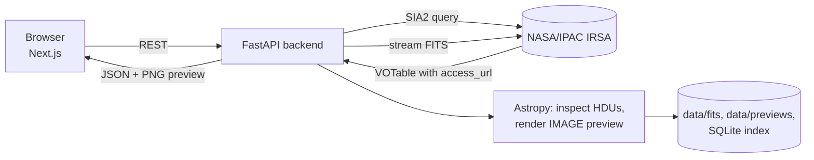

# SPHEREx Sky Viewer

A full-stack web app that turns a position on the sky into **real SPHEREx images**, shown in the order they were observed.

You enter a Right Ascension, Declination and search radius. The app searches NASA/IPAC IRSA for SPHEREx spectral images, downloads the FITS files you select, renders previews from the real `IMAGE` extension with Astropy, and lets you page through the observations like a flipbook.

> Data source: [NASA/IPAC Infrared Science Archive (IRSA)](https://irsa.ipac.caltech.edu), via the IVOA Simple Image Access v2 (SIA2) service.
> The app never uses sample, simulated or hardcoded observations. If IRSA fails or returns nothing, you see an error or an empty-result message.

---

## The problem

SPHEREx data is awkward to explore directly:

- Images are listed through IRSA's SIA2 service, which returns a table of file URLs.
- Each image is a multi-extension FITS file (roughly 70 MB in early tests).
- One pointing can come with several detector files.
- Watching a region change over time means opening many files by hand.

## The idea

Give the app a sky position. It finds the observations, fetches only the files you pick, and shows them in time order.

| Step | What happens |
|------|--------------|
| Search by position | RA, Dec and a radius find every overlapping observation. |
| Retrieve on demand | Metadata loads first. Heavy FITS files download only when selected. |
| Watch it change | Pointings are sorted by observation time and played like a flipbook. |

---

## Features

- **Search panel** with validated RA (0–360°), Dec (−90 to +90°), radius in arcsec / arcmin / deg, and a collection selector. An example target (WISE 0855) is prefilled.
- **Collections:** `spherex_dr1`, `spherex_dr1_deep`, `spherex_qr3`, `spherex_qr3_deep`.
- **Observation list** grouped by pointing and sorted chronologically, with per-detector files and live status badges.
- **Scientific image viewer:** zoom, pan, fit/reset, fullscreen, download the current preview, and click for the pixel value and RA/Dec (only when the file's header has a celestial WCS).
- **Extension inspector:** every FITS extension with its type, shape, data type and header. 2-D image extensions (for example `FLAGS`, `VARIANCE`) can be viewed.
- **Chronological flipbook:** play, pause, previous, next, timeline slider and 0.5x / 1x / 2x / 4x speed. Only frames with a real, processed preview are played.
- **Download manager:** reopen, download or delete stored FITS files.
- **Data guide** page explaining RA/Dec, FITS, FLAGS, VARIANCE and MJy/sr.

---

## How it works



1. **Search.** The frontend sends RA, Dec, radius and collection to the backend. The backend builds an SIA2 request (`COLLECTION`, `POS=circle ra dec radius_deg`, `MAXREC`) and parses the returned VOTable with Astropy.
2. **Discover.** Each row becomes a file record (stored in SQLite). The `access_url` column is the FITS URL.
3. **Retrieve.** When you select a file, a background job streams the FITS file to disk. The original is kept byte for byte.
4. **Process.** Astropy opens the file, lists its HDUs and renders a preview of the `IMAGE` extension.
5. **View.** The frontend polls status, then shows the preview, extension list and flipbook.

### Grouping and chronology

- IRSA file names follow `level2_<planning period>_<exposure>_2D<detector>_...fits`. Files with the same planning period and exposure are treated as detector products of **one pointing**. A file whose name does not match becomes its own group.
- A pointing's time is the **earliest `t_min`** among its files (MJD). The ISO date shown assumes UTC, and the MJD value is always shown beside it. Pointings with no `t_min` sort last.
- The flipbook plays **one detector at a time**, so one pointing's detector files are not treated as separate dates.

### Preview rendering

Previews are for display only: block-averaged to at most 1024 px, clipped to the 1st–99.5th percentile, asinh-stretched, with NaN/inf pixels masked. The scientific values stay in the original FITS file, which you can download unchanged.

### Status flow

`discovered → queued → downloading → downloaded → processing → processed` (or `failed`).
A file is marked `processed` only after Astropy opened it and the preview rendered successfully.

---

## Tech stack

| Layer | Technology |
|-------|-----------|
| Frontend | Next.js 14 (App Router), React, JavaScript, Tailwind CSS, Lucide icons |
| Backend | Python, FastAPI, Uvicorn, Requests |
| Science | Astropy (VOTable, FITS, WCS), NumPy, Matplotlib |
| Storage | Local files plus a SQLite index in `backend/data/` |

---

## Getting started

**Requirements:** Python 3.10+ and Node.js 18.17+ (Next.js 14). Internet access to `irsa.ipac.caltech.edu` is needed for real searches and downloads.

### Linux / macOS

```bash
# Backend
cd backend
python3 -m venv .venv && source .venv/bin/activate
pip install -r requirements.txt
uvicorn app.main:app --reload --port 8000     # API docs: http://localhost:8000/docs

# Frontend (second terminal)
cd frontend
cp ../.env.example .env.local
npm install
npm run dev                                    # http://localhost:3000
```

### Windows (PowerShell)

```powershell
# Backend
cd backend
py -m venv .venv
.\.venv\Scripts\Activate.ps1
pip install -r requirements.txt
uvicorn app.main:app --reload --port 8000

# Frontend (second terminal)
cd frontend
copy ..\.env.example .env.local
npm install
npm run dev
```

Open <http://localhost:3000>, keep the example target, and press **Search**.

### Configuration

Frontend (`frontend/.env.local`):

| Variable | Default | Purpose |
|----------|---------|---------|
| `NEXT_PUBLIC_API_URL` | `http://localhost:8000` | Backend base URL |

Backend (environment variables, all optional):

| Variable | Default | Purpose |
|----------|---------|---------|
| `SPX_DATA_DIR` | `backend/data` | Where FITS files, previews and the SQLite index are stored |
| `SPX_CORS_ORIGINS` | `http://localhost:3000,http://127.0.0.1:3000` | Allowed browser origins |
| `SPX_ALLOWED_HOSTS` | `irsa.ipac.caltech.edu` | Hosts the backend may download from |
| `SPX_MAX_WORKERS` | `2` | Concurrent download/processing jobs |
| `SPX_MAXREC` | `2000` | Max rows requested from SIA2 |
| `SPX_MAX_FITS_MB` | `600` | Max size accepted for one FITS download |
| `SPX_MAX_PREVIEW_PX` | `1024` | Longest side of a preview image |

---

## API

These are this app's own routes, not IRSA's. Interactive docs are at `/docs` when the backend is running.

| Method | Route | Purpose |
|--------|-------|---------|
| GET | `/api/health` | Backend health and IRSA reachability |
| GET | `/api/observations/collections` | Supported collections |
| POST | `/api/observations/search` | Search IRSA by RA, Dec, radius, collection |
| GET | `/api/observations/{group_id}` | One pointing and its files |
| GET | `/api/files/status?ids=` | Status of several files (used for polling) |
| POST | `/api/files/{file_id}/download` | Start download and processing |
| POST | `/api/files/download-batch` | Queue up to 25 files |
| GET | `/api/files/{file_id}/extensions` | FITS extensions and headers |
| GET | `/api/files/{file_id}/extensions/{ext}/preview` | PNG preview of an image extension |
| GET | `/api/files/{file_id}/extensions/{ext}/preview-info` | Display range, units, stretch details |
| GET | `/api/files/{file_id}/pixel?ext=&px=&py=` | Pixel value and RA/Dec at a click |
| GET | `/api/files/{file_id}/download-file` | Original FITS file |
| GET | `/api/downloads` | Locally stored files |
| DELETE | `/api/downloads/{file_id}` | Delete a stored file and its previews |

File routes use a `file_id` (one per detector file) because a pointing has several files.

---

## Safety and reliability

- The browser only talks to this backend, never to IRSA directly.
- The backend downloads only `https` URLs on allow-listed hosts, and re-checks every redirect hop. Users never supply download URLs, only opaque file ids.
- Downloads stream to a `.part` file, are checked for a FITS header, and have a size limit.
- Concurrent downloads and rendering are limited. Interrupted jobs are marked `failed` after a restart.
- A missing local file is detected and reported, not assumed to exist.

---

## Project structure

```text
spherex-sky-viewer/
├── backend/
│   ├── app/
│   │   ├── main.py            # FastAPI app
│   │   ├── config.py          # settings and constants
│   │   ├── db.py              # SQLite file index
│   │   ├── security.py        # URL allow-list, safe streaming
│   │   ├── api/               # observations, files, downloads, health routes
│   │   ├── schemas/search.py  # request validation
│   │   └── services/
│   │       ├── irsa_service.py      # SIA2 query, VOTable parsing, grouping
│   │       ├── fits_service.py      # HDU inspection, previews, pixel probe
│   │       └── download_service.py  # background download + processing
│   ├── tests/
│   ├── data/                  # fits/, previews/, index.sqlite3 (git-ignored)
│   └── requirements.txt
├── frontend/
│   ├── app/                   # pages: Explore, My Downloads, Data Guide
│   ├── components/            # SearchPanel, ScientificImageViewer, FlipbookControls, ...
│   ├── services/api.js        # all backend calls
│   └── package.json
├── .env.example
└── README.md
```

---

## Tests

```bash
cd backend
python -m pytest -q                 # offline tests
SPX_LIVE=1 python -m pytest -q -s   # also runs live IRSA searches (QR3 and DR1)
```

Offline tests cover input validation, the URL allow-list, VOTable parsing, grouping and sorting, FITS inspection and preview, a missing `IMAGE` extension and a corrupt file. They use small synthetic fixtures that exist only inside `backend/tests/`; the app itself never uses synthetic data.

---

## Known limitations

- Live behavior against IRSA (real results, ~70 MB downloads, real extension layout and WCS) depends on your network. Run the live tests first on a new setup.
- Pointing grouping relies on IRSA's file-name pattern shown above. If the pattern changes, files fall back to one group each.
- Observation times are converted from MJD assuming UTC.
- Pixel RA/Dec appears only when the extension's header contains a celestial WCS. Nothing is invented otherwise.
- Not included in this version: source detection, comparisons between epochs, cutouts and AI-based analysis.

---

## Data and acknowledgements

- SPHEREx data are served by NASA/IPAC IRSA. See the [SPHEREx Data Access guide](https://caltech-ipac.github.io/spherex-archive-documentation/spherex-data-access) for collections and file layout, and the [SIA2 documentation](https://irsa.ipac.caltech.edu/ibe/sia.html) for query parameters.
- Built with Next.js, FastAPI and Astropy.

## License

Add a license of your choice (for example MIT) before publishing.
