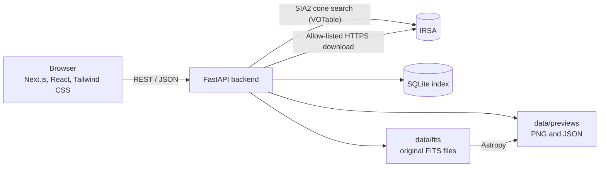

# SPHEREx Sky Viewer

A web application for searching, retrieving and visualising real SPHEREx spectral images from NASA/IPAC's Infrared Science Archive (IRSA).

Built with Next.js, FastAPI and Astropy.

---

## Contents

1. [Overview](#overview)
2. [Problem Statement](#problem-statement)
3. [Solution](#solution)
4. [Key Features](#key-features)
5. [Architecture](#architecture)
6. [Implementation Details](#implementation-details)
7. [Getting Started](#getting-started)
8. [Configuration](#configuration)
9. [API Reference](#api-reference)
10. [Testing](#testing)
11. [Project Status](#project-status)
12. [Repository Structure](#repository-structure)
13. [Data Source and References](#data-source-and-references)

---

## Overview

SPHEREx is a NASA infrared space telescope that observes the sky in many narrow wavelength bands. Its spectral images are distributed by IRSA as multi-extension FITS files.

SPHEREx Sky Viewer provides a single interface for the full workflow: query the archive by sky position, select observations, retrieve the original FITS files, inspect their contents and view them as images or as a time-ordered sequence.

The application uses real archive data only. No sample or simulated data is used anywhere in the application code. If IRSA is unreachable or returns no matches, the interface reports that directly. Synthetic fixtures exist solely inside the automated tests.

## Problem Statement

Working with SPHEREx data through the archive involves several manual steps:

- **Archive queries.** Observations are found through IRSA's SIA2 service using a sky position, a search radius and a collection. Collections are separated by data release and by survey type.
- **File-level results.** Search results are a list of files rather than observations. A single telescope pointing is split across several detector files, which makes the raw list difficult to interpret.
- **Large files.** Each FITS file is large (the application assumes roughly 70 MB per file when prompting for downloads), so retrieval should be selective.
- **Non-browser format.** FITS cannot be displayed in a browser. Viewing an image requires opening the file, selecting the correct extension, handling invalid pixels and applying an intensity stretch.
- **Temporal comparison.** Reviewing how a region changes between observations requires sorting files by time and stepping through them manually.

These steps are routine for an experienced user with a Python environment, but they create a significant barrier for quick exploration.

## Solution

The application places a FastAPI backend between the browser and IRSA. The backend handles discovery, download, validation and rendering, and exposes a small REST API to a Next.js frontend.

1. The user enters a position (RA/Dec), a radius and a collection.
2. The backend queries IRSA and groups detector files into pointings.
3. The user chooses which files to retrieve. Nothing is downloaded during a search.
4. The backend downloads each file, validates it with Astropy and renders a PNG preview.
5. The user inspects extensions and headers, probes pixel values and sky coordinates, or plays pointings back chronologically.

## Key Features

- **Cone search** against IRSA SIA2 for four collections: `spherex_dr1`, `spherex_dr1_deep`, `spherex_qr3` and `spherex_qr3_deep`.
- **Pointing grouping.** Detector files from the same exposure are presented together, with detector selection inside each pointing.
- **On-demand retrieval.** Single or batch downloads (up to 25 files) run as background jobs with live status and progress.
- **Scientific image viewer.** Zoom, pan, fullscreen, FITS extension switching and preview export.
- **Pixel probe.** Full-resolution pixel position, value and units on click, with RA/Dec when the file header contains a celestial WCS.
- **Extension inspector.** Type, shape and data type for every HDU, plus a header viewer.
- **Chronological flipbook.** Playback, stepping, scrubbing and speed control for a selected detector, using only frames with a rendered preview.
- **Download manager.** List, reopen, re-download and delete files stored on the server.
- **Data guide.** In-app reference for RA/Dec, FITS extensions, units and detectors.
- **Service health indicator.** Shows whether the backend and IRSA are reachable.

## Architecture



The browser communicates only with the application's own backend. It never contacts IRSA directly and refers to files by opaque identifiers rather than URLs.

## Implementation Details

### Discovery (`irsa_service.py`)

- Queries `https://irsa.ipac.caltech.edu/SIA` using the `COLLECTION`, `POS=circle <ra> <dec> <radius_deg>` and `MAXREC` parameters. The default VOTable response is parsed with `astropy.io.votable`.
- All returned columns are retained. Optional columns may be absent.
- **Grouping.** IRSA file names follow the pattern `level2_<period>_<exposure>_2D<detector>_...fits`. Files with the same period and exposure form one pointing. Names that do not match become individual groups.
- **Chronological order.** A pointing's time is the earliest `t_min` (MJD) among its files. Dates are displayed assuming UTC, with the MJD shown alongside. Pointings without `t_min` are sorted last.

### Retrieval and processing (`download_service.py`)

- A thread pool (default: 2 workers) executes jobs while the frontend polls for status.
- Status flow: `discovered`, `queued`, `downloading`, `downloaded`, `processing`, `processed`, or `failed`.
- Files stream to a temporary `.part` file, are checked against the size limit and the FITS `SIMPLE` signature, then renamed.
- A file is marked `processed` only after Astropy has opened it and the preview has been rendered.
- Original files are stored unmodified.

### FITS inspection and rendering (`fits_service.py`)

- Files are opened read-only.
- Only two-dimensional image extensions are previewable.
- Preview pipeline (for display only): block-average to at most 1024 px on the long side, mask NaN and infinite values, clip to the 1st to 99.5th percentile, then apply an `asinh` stretch. The `FLAGS` extension is rendered as a binary mask.
- The pixel probe maps a click on the downsampled preview to full-resolution coordinates and reads the value. Sky coordinates are computed through the header WCS when present. Otherwise the response states that no celestial WCS is available.

### Persistence (`db.py`)

- A SQLite index and the files under `backend/data/` persist across restarts.
- At startup, jobs interrupted by a restart are marked `failed`.
- Before reporting a file as available, the backend confirms it still exists on disk. Missing files are reset to `discovered` and can be retrieved again.

### Security (`security.py`, `schemas/search.py`)

- **SSRF protection.** The server fetches only `https` URLs on allow-listed hosts (default: `irsa.ipac.caltech.edu`) without embedded credentials. Redirects are followed manually, up to three hops, and each hop is re-validated.
- **Input validation.** RA must be within 0 to 360, Dec within -90 to +90, radius positive and no greater than 0.5 degrees, and the collection must be a known value.
- **Resource limits.** Batch size is capped at 25, download size is capped (default: 600 MB), and concurrent preview rendering is limited by a semaphore.
- **Untrusted records.** Records whose `access_url` is outside the allow-list remain visible but are flagged, and retrieval is disabled for them.

### Frontend (`frontend/`)

- Next.js 14 (App Router), React 18, Tailwind CSS and lucide-react.
- Routes: `/` (Explore), `/downloads` and `/guide`.
- `services/api.js` is the single client for backend calls and converts FastAPI error payloads into readable messages.
- The Explore page uses three columns: search and results, viewer and flipbook, and observation details with the extension inspector.

## Getting Started

### Prerequisites

- Python 3 with `venv`
- Node.js and npm
- Network access to `irsa.ipac.caltech.edu` for live searches and downloads

### Linux and macOS

```bash
# Backend
cd backend
python3 -m venv .venv && source .venv/bin/activate
pip install -r requirements.txt
uvicorn app.main:app --reload --port 8000    # API docs: http://localhost:8000/docs

# Frontend (separate terminal)
cd frontend
cp ../.env.example .env.local                # keep only NEXT_PUBLIC_API_URL
npm install
npm run dev                                  # http://localhost:3000
```

### Windows (PowerShell)

```powershell
# Backend
cd backend
py -m venv .venv
.\.venv\Scripts\Activate.ps1
pip install -r requirements.txt
uvicorn app.main:app --reload --port 8000

# Frontend (separate terminal)
cd frontend
copy ..\.env.example .env.local
npm install
npm run dev
```

### Example query

The search form is pre-filled with RA `133.795129`, Dec `-7.245147`, a 30 arcsec radius and the `spherex_qr3` collection. Submit the search, select a result, then choose **Retrieve FITS** in the details panel.

## Configuration

Backend settings are optional environment variables, defined in `backend/app/config.py`.

| Variable | Default | Description |
|---|---|---|
| `SPX_DATA_DIR` | `backend/data` | Location of the SQLite index, FITS files and previews |
| `SPX_CORS_ORIGINS` | `http://localhost:3000,http://127.0.0.1:3000` | Allowed browser origins |
| `SPX_MAX_WORKERS` | `2` | Concurrent download and processing jobs |
| `SPX_MAXREC` | `2000` | Maximum records requested from IRSA per search |
| `SPX_MAX_FITS_MB` | `600` | Per-file download size limit |
| `SPX_MAX_PREVIEW_PX` | `1024` | Maximum preview size (long side) |
| `SPX_ALLOWED_HOSTS` | `irsa.ipac.caltech.edu` | Hosts the server may fetch from |

Frontend: set `NEXT_PUBLIC_API_URL` (default `http://localhost:8000`) in `frontend/.env.local`.

## API Reference

This is the application's own API, not IRSA's. Interactive documentation is available at `/docs` while the backend is running.

| Method | Route | Description |
|---|---|---|
| `GET` | `/api/health` | Backend status and IRSA reachability (`?check_irsa=false` to skip the IRSA check) |
| `GET` | `/api/observations/collections` | Available collections |
| `POST` | `/api/observations/search` | Search IRSA and return grouped pointings |
| `GET` | `/api/observations/{group_id}` | A single pointing and its files |
| `GET` | `/api/files/{file_id}` | A single file record |
| `GET` | `/api/files/status?ids=` | Status of up to 200 files |
| `POST` | `/api/files/{file_id}/download` | Queue a download |
| `POST` | `/api/files/download-batch` | Queue up to 25 downloads |
| `GET` | `/api/files/{file_id}/extensions` | FITS extensions and headers |
| `GET` | `/api/files/{file_id}/extensions/{ext}/preview` | PNG preview |
| `GET` | `/api/files/{file_id}/extensions/{ext}/preview-info` | Stretch, shape and units used for the preview |
| `GET` | `/api/files/{file_id}/pixel` | Pixel value and sky coordinates at a position |
| `GET` | `/api/files/{file_id}/download-file` | Original FITS file |
| `GET` | `/api/downloads` | Files stored on the server |
| `DELETE` | `/api/downloads/{file_id}` | Delete a stored file and its previews |

File routes use a `file_id` (one per detector file) because a pointing contains several files.

## Testing

```bash
cd backend

# Offline tests
python -m pytest -q

# Include live IRSA searches (requires network access)
SPX_LIVE=1 python -m pytest -q -s
```

The offline suite covers search input validation, the SSRF allow-list, VOTable parsing, grouping and chronological sorting, FITS inspection and preview rendering, pixel probing without a WCS, handling of missing `IMAGE` extensions and corrupt files, and health and unknown-ID responses. The live tests query `spherex_qr3` and `spherex_dr1`.

## Project Status

Current version: `0.1.0`.

**Validated** in a sandbox without network access: backend start-up, health endpoint, input validation, VOTable parsing, grouping and sorting, the SSRF allow-list, FITS inspection, preview and probe, error handling for missing-`IMAGE` and corrupt files, a `502` response when IRSA is unreachable, and a production build of the frontend.

**Pending validation** on a networked machine:

- Live IRSA search results
- Retrieval of a full-size SPHEREx FITS file
- Behaviour against the actual SPHEREx HDU layout and WCS
- End-to-end operation of the interface in a browser

**Known limitations**

- Grouping depends on IRSA's file naming convention, taken from IRSA's documented example URLs. Files with non-matching names are shown as individual groups.
- Timestamps are displayed assuming UTC.
- Previews are display transformations and are not suitable for quantitative analysis. Use the original FITS files for measurements.
- The application has no authentication and stores downloads on local disk. It is intended for local or trusted deployments.

## Repository Structure

```
spherex-sky-viewer/
├── backend/
│   ├── app/
│   │   ├── main.py              # Application entry point, CORS, startup recovery
│   │   ├── config.py            # Settings and collections
│   │   ├── security.py          # URL allow-list and redirect-safe streaming
│   │   ├── db.py                # SQLite index
│   │   ├── schemas/search.py    # Search request validation
│   │   ├── api/                 # health, observations, files, downloads
│   │   └── services/            # irsa_service, download_service, fits_service
│   ├── tests/
│   ├── data/                    # fits/ and previews/ (contents git-ignored)
│   └── requirements.txt
├── frontend/
│   ├── app/                     # Explore, downloads and guide pages
│   ├── components/              # Viewer, search, flipbook and inspector components
│   └── services/api.js          # Backend client
├── .env.example
└── .gitignore
```

## Data Source and References

All observation data is provided by NASA/IPAC IRSA.

- [SPHEREx data products](https://caltech-ipac.github.io/spherex-archive-documentation/spherex-data-products)
- [SPHEREx data access](https://caltech-ipac.github.io/spherex-archive-documentation/spherex-data-access)
- [SPHEREx Explanatory Supplement](https://irsa.ipac.caltech.edu/data/SPHEREx/docs/SPHEREx_Expsupp.pdf)

Built with [FastAPI](https://fastapi.tiangolo.com/), [Astropy](https://www.astropy.org/), [Next.js](https://nextjs.org/) and [Tailwind CSS](https://tailwindcss.com/).
